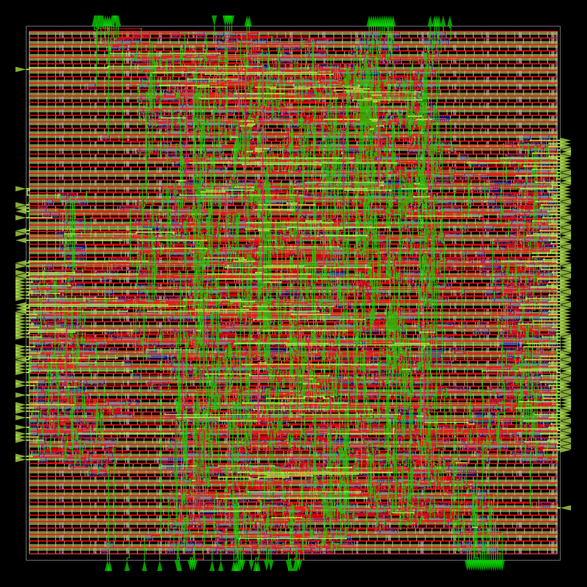
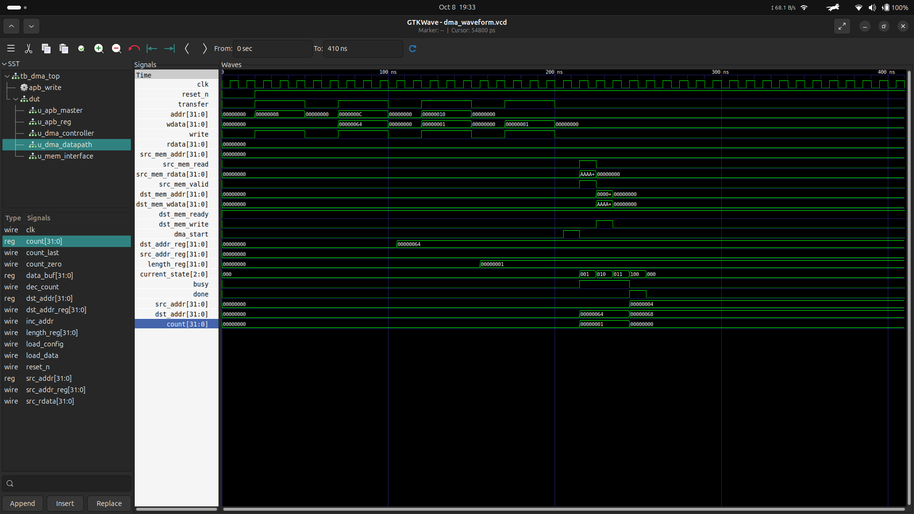

# APB-Controlled DMA Engine — RTL to GDSII

A Verilog-based DMA engine that transfers data from a source memory address to a destination memory address with minimal CPU involvement. The CPU configures the transfer through an APB interface, and the DMA controller manages the read, write, and address-update sequence.

The design was implemented with the SKY130HD standard-cell library using OpenROAD-flow-scripts. The RTL, testbenches, constraints, reports, scripts, and screenshots are included in this repository.

## How the Project Works

1. The CPU starts an APB transaction and writes the DMA configuration registers.
2. The source address, destination address, and transfer length are stored in the register block.
3. Writing `1` to the control register's bit 0 generates a one-clock `dma_start` pulse.
4. The DMA controller reads one 32-bit word from the source memory interface.
5. The datapath stores the word in `data_buf`.
6. The controller writes the buffered word to the destination memory interface.
7. The source and destination addresses advance by 4 bytes, and the remaining word count decreases by one.
8. The controller repeats the read/write sequence until the last word is processed, then asserts `done`.

This implementation uses 32-bit data and increments addresses by four bytes per transfer. The memory interface is represented by input and output signals; an external memory model or memory system must respond to those signals.

## RTL Modules

| File | Purpose |
|---|---|
| `rtl/dma_top.v` | Top-level module. Connects the APB master, register block, DMA controller, datapath, and memory interface. |
| `rtl/apb_master.v` | Converts the external `transfer`, `addr`, `wdata`, and `write` inputs into APB setup/access transactions and returns read data through `rdata`. |
| `rtl/apb_reg.v` | Stores the DMA configuration registers, generates the start pulse, and provides status/configuration values for APB reads. |
| `rtl/dma_controller.v` | Finite-state machine (FSM) that sequences source reads, destination writes, address updates, and completion. |
| `rtl/dma_datapath.v` | Holds the active source and destination addresses, transfer count, and one-word data buffer. It increments addresses and decrements the count. |
| `rtl/mem_interface.v` | Converts controller commands into source-memory read and destination-memory write signals, and returns data-valid/ready handshakes. |

## APB Register Map

The register addresses are defined in `rtl/apb_reg.v`.

| Address | Register | Function |
|---|---|---|
| `0x00` | Control | Writing bit 0 as `1` requests a DMA start. Reads return the stored control value. |
| `0x04` | Status | Read-only status: bit 0 = `busy`, bit 1 = `done`, bit 2 = `error`. |
| `0x08` | Source address | Source memory address for the transfer. |
| `0x0C` | Destination address | Destination memory address for the transfer. |
| `0x10` | Length | Number of 32-bit words to transfer. |

The status register is assembled as `{29'b0, dma_error, dma_done, dma_busy}`. In the current top-level design, `dma_error` is tied to zero.

## DMA Controller States

The controller uses five FSM states:

- **IDLE:** Waits for `start` and loads the configuration when a start request is received.
- **READ:** Requests source data and waits for `src_rvalid`.
- **WRITE:** Requests a destination write and waits for `dst_ready`.
- **UPDATE:** Advances both addresses by 4 bytes and decrements the word count. If the count indicates the last word, it moves to `DONE`; otherwise, it returns to `READ`.
- **DONE:** Asserts `done` for the completion state, then returns to `IDLE`.

The main control sequence is:

`IDLE → READ → WRITE → UPDATE → READ ... → DONE → IDLE`

The path from `READ` to `WRITE` depends on `src_rvalid`; the path from `WRITE` to `UPDATE` depends on `dst_ready`; and the path from `UPDATE` either repeats the transfer or finishes based on `count_last`.

## Testbenches and Simulation

The `testbench/` directory contains:

- `tb_dma_top.v` — top-level DMA testbench.
- `tb_apb_only.v` — APB-focused testbench.
- `tb_dut_only.v` — DUT-focused testbench.
- `tb_clock_only.v` — clock-focused testbench.

From the repository root, try compiling the top-level testbench with Icarus Verilog:

```bash
iverilog -g2012 -o /tmp/dma_sim rtl/*.v testbench/tb_dma_top.v
vvp /tmp/dma_sim
```

If the testbench writes a VCD waveform, open the VCD file from the directory where it was generated:

```bash
gtkwave path/to/dma_waveform.vcd
```

The exact waveform filename and output location depend on the `$dumpfile` statement in the testbench. The testbench should be checked for its required memory-response behavior before treating the waveform as proof of a successful data copy.

## Tools and Platform

- **Verilog HDL** — RTL implementation.
- **Icarus Verilog** — RTL simulation.
- **GTKWave** — waveform inspection.
- **Verilator** — RTL lint checks.
- **Yosys** — logic synthesis and technology mapping.
- **OpenROAD-flow-scripts / OpenROAD** — ASIC physical-design flow.
- **OpenSTA** — static timing analysis.
- **SKY130HD** — standard-cell library and technology platform.
- **KLayout** — layout viewing and DRC checking.
- **Magic and Netgen** — available supporting layout/LVS tools; LVS has not been successfully verified for this run.
- **OSS CAD Suite** — local bundle used for open-source digital-design tools.

## ASIC Implementation Flow

The design was taken through these stages:

1. RTL synthesis and checks.
2. Floorplanning and power-distribution generation.
3. Placement.
4. Clock-tree synthesis (CTS).
5. Global and detailed routing.
6. Parasitic extraction and static timing analysis.
7. KLayout DRC check.
8. GDSII generation.

The `constraints/` folder contains the timing constraints and flow configuration. The `scripts/` folder contains STA scripts. The `reports/` folder contains synthesis, placement, CTS, routing, timing, and DRC reports. The `images/` folder contains physical-design screenshots and the simulation waveform, if added.

## Reported Results

| Metric | Result |
|---|---:|
| Technology | SKY130HD |
| Clock target | 50 MHz |
| Clock period | 20 ns |
| Worst reported setup slack | +15.90 ns |
| Worst reported hold slack | +0.45 ns |
| Reported KLayout DRC violations | 0 |
| GDSII | Generated |

The reported timing run met the 50 MHz constraint with positive setup and hold slack. These values describe the reported run and are not a claim of foundry signoff.

## Layout and Waveform

### Placement


### Routed layout



### Simulation waveform

Add a GTKWave screenshot at `images/dma_waveform.png` and uncomment the image below when the file is present.

<!--  -->

## Repository Structure

```text
.
├── constraints/   Timing constraints and OpenROAD configuration
├── docs/          Additional project documentation
├── images/        Layout screenshots and waveform images
├── reports/       Synthesis, timing, routing, and DRC reports
├── rtl/           Verilog RTL modules
├── scripts/       STA scripts
├── testbench/     Simulation testbenches
└── README.md
```

## Current Status and Limitations

- GDSII generation completed.
- The reported KLayout DRC run reported zero violations.
- LVS remains unresolved: the current KLayout LVS run stopped while parsing the SKY130HD reference CDL, so layout-versus-schematic equivalence has not been verified.
- The maximum operating frequency has not been established.
- This is an educational implementation and is not claimed to be tapeout-ready.

## Git Branch

The main development branch is `main`.

## Author

**Prathamesh Desai**  
[GitHub: Pratham-Bit-Flip](https://github.com/Pratham-Bit-Flip)
