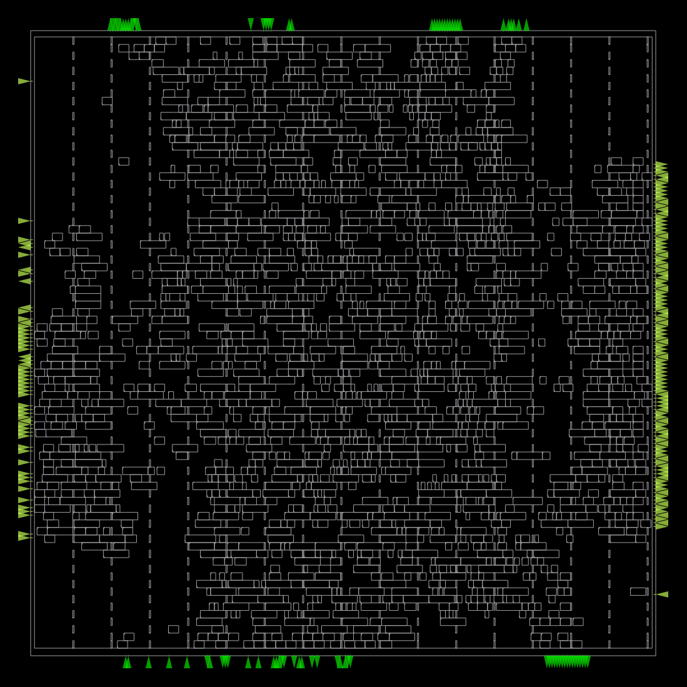

# APB-Controlled DMA Engine — RTL to GDSII

A Verilog-based DMA controller implemented with the SKY130HD standard-cell library and OpenROAD-flow-scripts.

## Features

- APB-based configuration registers
- DMA controller and datapath
- Source and destination address management
- Memory interface
- RTL simulation and ASIC physical-design flow

## Tools

- Verilog HDL
- Icarus Verilog
- GTKWave
- OpenROAD
- SKY130HD
- KLayout

## Project Structure

```text
rtl/          Verilog source files
testbench/    Simulation testbenches
constraints/  Timing constraints and flow configuration
scripts/      STA scripts
reports/      Synthesis, timing, and DRC reports
images/       Physical-design screenshots
```

## Run Simulation

From the repository root:

```bash
iverilog -g2012 -o /tmp/dma_sim rtl/*.v testbench/tb_dma_top.v
vvp /tmp/dma_sim
```

If the simulation produces a VCD waveform, open it with GTKWave:

```bash
gtkwave dma_waveform.vcd
```

## ASIC Implementation

The design was implemented using OpenROAD-flow-scripts and SKY130HD.

Stages completed:
1. Synthesis
2. Floorplanning and power distribution
3. Placement
4. Clock-tree synthesis
5. Routing
6. Static timing analysis
7. KLayout DRC check
8. GDSII generation

## Results

| Metric | Result |
|---|---|
| Technology | SKY130HD |
| Clock target | 50 MHz |
| Clock period | 20 ns |
| Worst reported setup slack | +15.90 ns |
| Worst reported hold slack | +0.45 ns |
| Reported KLayout DRC violations | 0 |
| GDSII | Generated |

Timing met the 50 MHz constraint in the reported run. Maximum operating frequency has not been established.

## Layout

### Placement


### Routed Layout


## Status

LVS is unresolved. The current KLayout run stops while parsing the SKY130HD reference CDL, so layout-versus-schematic equivalence has not been verified.

This is an educational ASIC implementation project and is not claimed to be tapeout-ready.

## Author

**Prathamesh Desai**  
[GitHub: Pratham-Bit-Flip](https://github.com/Pratham-Bit-Flip)
